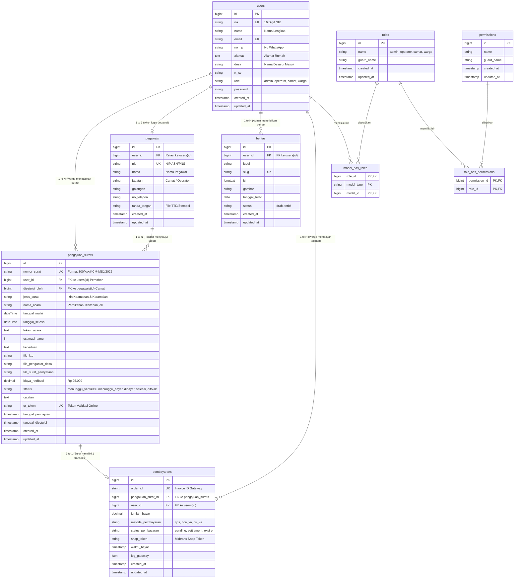

# Perancangan Entity Relationship Diagram (ERD)
## Sistem Informasi Pelayanan Masyarakat Kantor Kecamatan Mesuji
**Penulis:** Alfan Ardi Putra (NPM: 21430094)  
**Institusi:** Universitas Muhammadiyah Metro (2025/2026)  
**Database:** MySQL (`db_pelayanan_mesuji`)  
**Tingkat Normalisasi:** 1NF, 2NF, 3NF (Valid & Lengkap)

---

### Diagram Relasi Antar Tabel (Mermaid ERD)

---

### Cara Download Gambar ERD (PNG / SVG):
Buka di browser Anda:
👉 **http://localhost/pelayanan%20mesuji/public/erd.html**  
Lalu klik tombol **"Download Gambar PNG"** atau **"Download Gambar SVG"**.

