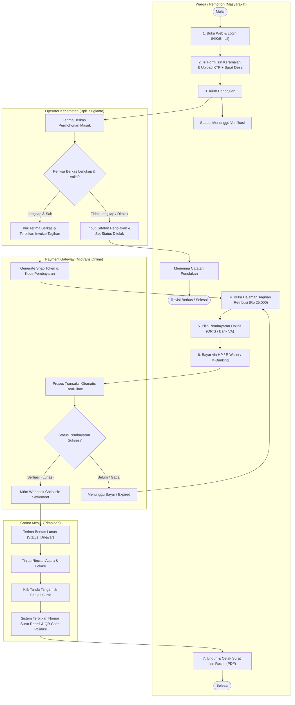
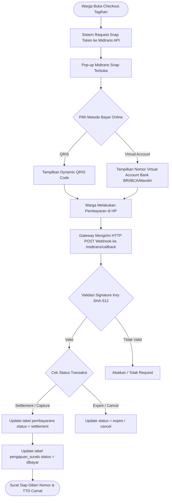

# Bagan Alir Sistem Informasi (Flowchart)
## Sistem Informasi Pelayanan Masyarakat Kantor Kecamatan Mesuji
**Penulis:** Alfan Ardi Putra (NPM: 21430094)  
**Institusi:** Universitas Muhammadiyah Metro (2025/2026)  
**Metodologi:** Rational Unified Process (RUP)

---

### 1. Flowchart Aliran Sistem Antar-Aktor (Cross-Functional Swimlane)

---

### 2. Flowchart Khusus Integrasi Online Payment Gateway (Midtrans)

---

### Cara Download Gambar Flowchart (PNG / SVG):
Buka di browser Anda:  
👉 **http://localhost/pelayanan%20mesuji/public/flowchart.html**  
Lalu klik tombol **"Download Gambar PNG"** atau **"Download Gambar SVG"**.

